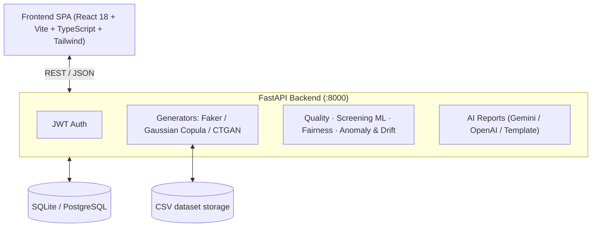

# TenantSynth AI – Synthetic Rental Application Generator

[](https://fastapi.tiangolo.com)
[](https://react.dev)
[](https://tailwindcss.com)
[](https://sdv.dev)

> **⚠️ Research & testing only.** Every generated record is fictional. TenantSynth AI does not generate real personal data and must not be used for real tenant screening, leasing decisions, or credit underwriting.

TenantSynth AI is a full-stack generative AI platform that creates realistic synthetic rental application datasets. Researchers and data scientists can use it to test screening models, audit them for fairness, and simulate market shifts without touching real tenant data.

---

## Why

- **Privacy:** Real rental applications contain sensitive financial and personal data that is risky to share or pool.
- **Cold start:** Teams entering new markets often have little or no training data.
- **Bias:** Screening models can reproduce socio-economic bias. Auditing them needs controlled, privacy-safe benchmark data.

---

## Features

| Module | What it does |
|---|---|
| **Synthetic Generator** | Three engines: Faker baseline, Gaussian Copula (SDV) and CTGAN. Configurable record count, seed, income/rent/credit ranges and missing-value rate. |
| **Scenario Builder** | 10 preset applicant profiles (salaried, self-employed, freelancer, first-time renter, thin credit file, high debt, missing documents, and more) plus custom scenarios. |
| **Data Laboratory** | Filter, search, sort and inspect column distributions of any dataset. |
| **Quality Analysis** | Column statistics, Kolmogorov–Smirnov tests, categorical frequency checks, correlation similarity, missingness and duplicate audits. |
| **Screening Simulator** | Trains Logistic Regression, Decision Tree, Random Forest and Gradient Boosting models. Shows ROC-AUC, F1, confusion matrix and feature importance. |
| **Fairness Analysis** | Disparate impact ratio, selection rates, and FPR/FNR parity across cohorts. |
| **Anomaly & Drift** | Injects edge-case anomalies and simulates distribution shifts, such as rent increases or a surge in gig workers. |
| **Report Generator** | Writes AI summary reports with Google Gemini or OpenAI. Uses a built-in template engine when no API key is set. |
| **Exports** | Download datasets as CSV, XLSX or JSON. |

**Ethical safeguards:** Protected characteristics (race, religion, sex, disability, familial status, national origin) are never generated or used as model features. Models use only objective risk factors such as debt-to-income ratio, rent-to-income ratio and verified income.

---

## Architecture



**Generation flow:** The UI sends `POST /api/generation/generate`, and the backend creates a dataset record and starts a background job. The UI polls `GET /api/generation/jobs/{id}`. When the job finishes, the CSV is saved to `storage/` and can be previewed or exported.

---

## Tech Stack

| Layer | Technologies |
|---|---|
| Frontend | React 18, TypeScript, Vite, Tailwind CSS, Recharts, React Router, Axios, Lucide icons |
| Backend | FastAPI, Uvicorn, Pydantic v2, SQLAlchemy 2.0, JWT (python-jose, passlib) |
| Synthetic data | SDV (Gaussian Copula, CTGAN), Faker |
| ML / stats | scikit-learn, SciPy, NumPy, pandas |
| AI reports | Google Generative AI SDK, OpenAI API, built-in template fallback |
| Database | SQLite (default), PostgreSQL-compatible |

---

## Project Structure

```
tenantsynth-ai/
├── backend/
│   ├── app/
│   │   ├── api/          # REST route handlers
│   │   ├── analytics/    # quality validator, anomaly injector, drift analyzer
│   │   ├── core/         # config, security, dependencies
│   │   ├── database/     # engine, session, init
│   │   ├── generators/   # faker, gaussian copula, ctgan
│   │   ├── ml/           # screening model, fairness analyzer, evaluation
│   │   ├── models/       # SQLAlchemy models
│   │   ├── reports/      # AI report generator
│   │   ├── schemas/      # Pydantic schemas
│   │   └── main.py
│   ├── tests/
│   └── requirements.txt
├── frontend/
│   └── src/              # pages, components, hooks, services, types
├── storage/              # generated datasets (git-ignored)
├── .env.example
└── start_all.bat         # Windows: launch backend + frontend
```

---

## Getting Started

### Prerequisites
- Python 3.10–3.12
- Node.js 18+

### 1. Clone

```bash
git clone https://github.com/sriakshaya10/Tenant.git
cd Tenant
```

### 2. Backend

```bash
cd backend
python -m venv venv
# Windows: .\venv\Scripts\Activate.ps1   |   macOS/Linux: source venv/bin/activate
pip install -r requirements.txt
cp ../.env.example .env          # Windows PowerShell: Copy-Item ..\.env.example .env
python -m uvicorn app.main:app --host 127.0.0.1 --port 8000 --reload
```

- Swagger UI: http://localhost:8000/docs
- ReDoc: http://localhost:8000/redoc

### 3. Frontend

```bash
cd frontend
npm install
npm run dev
```

Open http://localhost:5173, create an account at `/register`, and start generating datasets.

> **Windows shortcut:** After installing dependencies, run `start_all.bat` to start both servers.

---

## Environment Variables

The backend reads `backend/.env` (template: [`.env.example`](.env.example)).

| Variable | Description | Default |
|---|---|---|
| `DATABASE_URL` | SQLAlchemy connection string | `sqlite:///./tenantsynth.db` |
| `SECRET_KEY` | JWT signing key. **Change this in any shared deployment.** | dev placeholder |
| `ALGORITHM` | JWT algorithm | `HS256` |
| `ACCESS_TOKEN_EXPIRE_MINUTES` | Token lifetime | `60` |
| `GEMINI_API_KEY` | Optional. Enables Gemini-written reports. | empty |
| `OPENAI_API_KEY` | Optional. Enables OpenAI-written reports. | empty |
| `CORS_ORIGINS` | Allowed frontend origins (JSON list) | localhost ports |
| `MAX_RECORDS_LIMIT` | Max records per generation | `50000` |
| `STORAGE_PATH` | Folder for generated datasets | `../storage` |

No LLM key is required. Without one, reports come from the built-in template engine.

---

## API Overview

All endpoints are under `/api`. Full interactive docs are at `/docs`.

| Group | Key endpoints |
|---|---|
| Auth | `POST /auth/register`, `POST /auth/login`, `GET /auth/me` |
| Dashboard | `GET /dashboard/stats`, `GET /dashboard/activity` |
| Datasets | `GET /datasets`, `GET /datasets/{id}/preview`, `DELETE /datasets/{id}` |
| Generation | `POST /generation/generate`, `GET /generation/jobs`, `POST /generation/jobs/{id}/cancel` |
| Scenarios | `GET /scenarios`, `POST /scenarios`, `PUT /scenarios/{id}` |
| Quality | `GET /quality/reports/{dataset_id}` |
| Models | `GET /models/experiments` |
| Fairness / Anomalies / Drift | `GET /{group}/experiments` |
| Reports | `GET /reports/dataset/{dataset_id}` |
| Exports | `GET /exports/{id}/csv`, `/xlsx`, `/json` |

---

## Testing

```bash
# Backend
cd backend
python -m pytest tests/ -v

# Frontend type-check + production build
cd frontend
npm run build
```

Backend tests cover authentication, generation (constraints and seed reproducibility), data quality metrics, and ML/fairness analytics.

---

## Troubleshooting

- **`python` opens the Microsoft Store / permission denied (Windows):** Use `python -m ...`, or move your Python install above `WindowsApps` in `PATH`.
- **SDV / PyTorch install issues:** Use the pinned versions in `requirements.txt`. If deep generative libraries are unavailable, the app falls back to the Faker engine.
- **No LLM key:** This is expected to work. Reports use the deterministic template engine.

---

## Roadmap

- Multi-table synthesis (leases, tenants, maintenance requests)
- Differential privacy (ε, δ) guarantees
- Time-series simulation of monthly payment history
